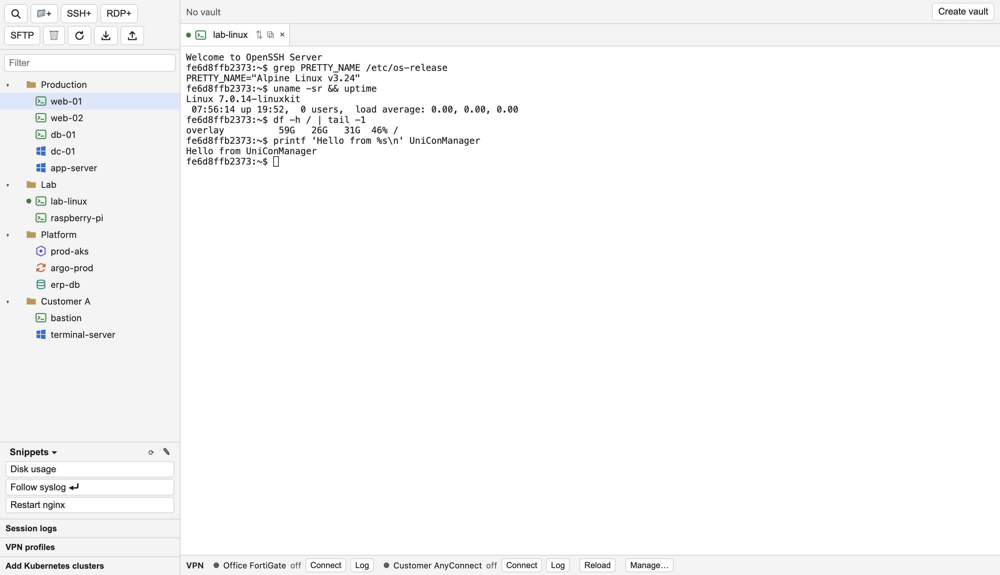
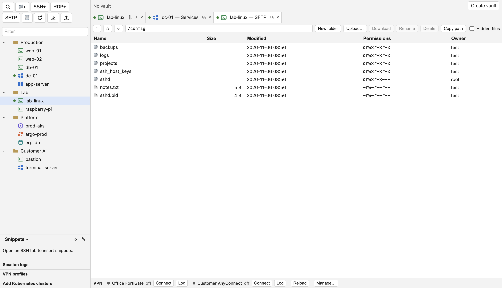
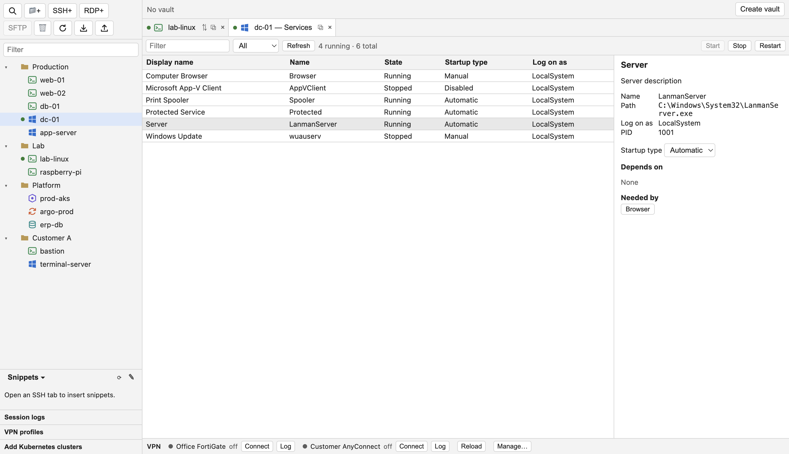
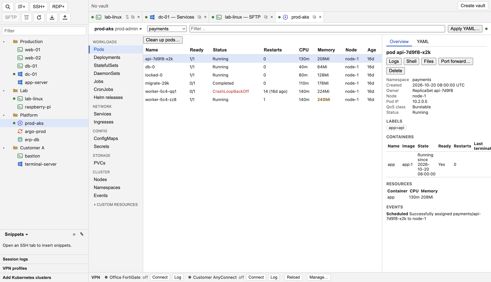
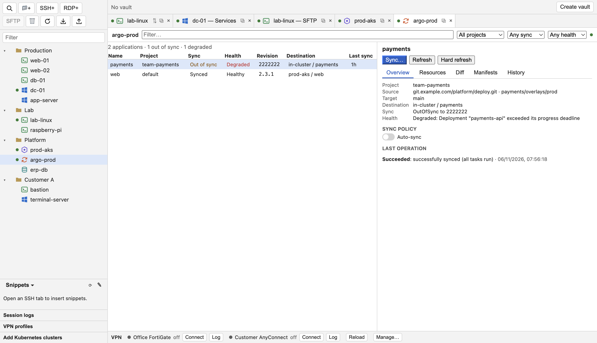
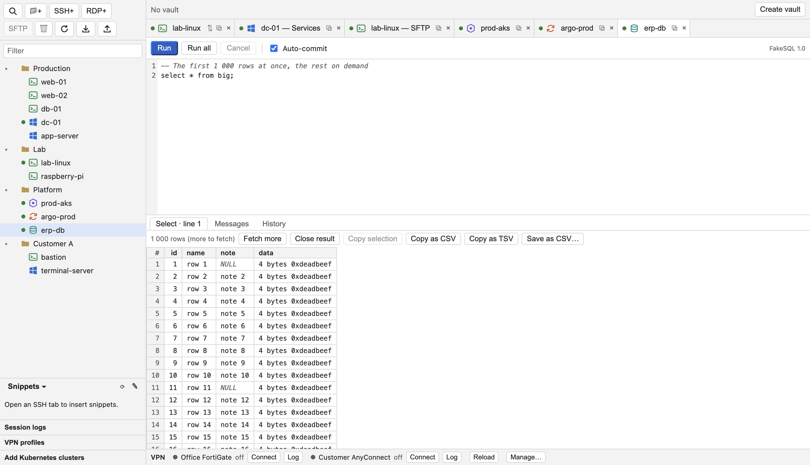
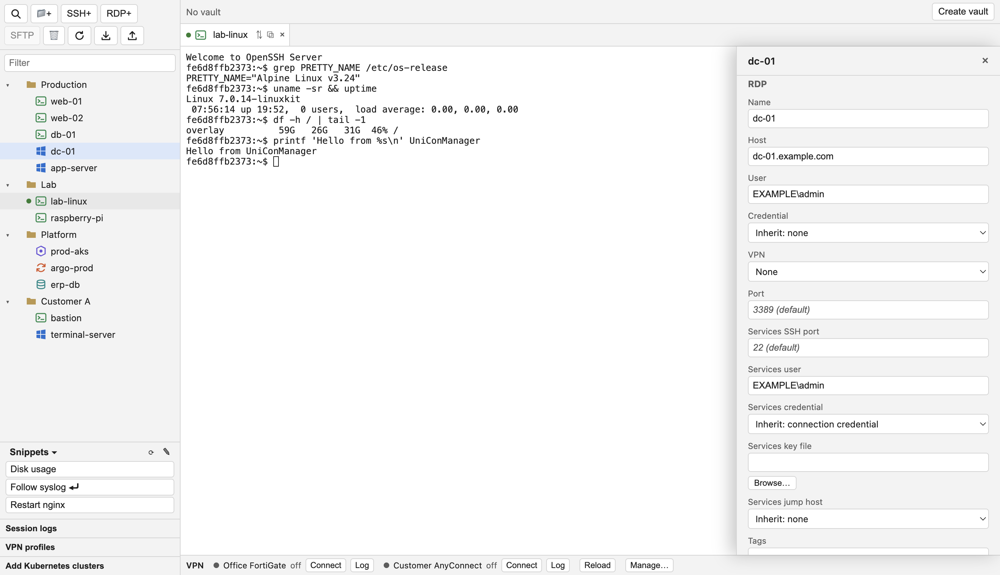
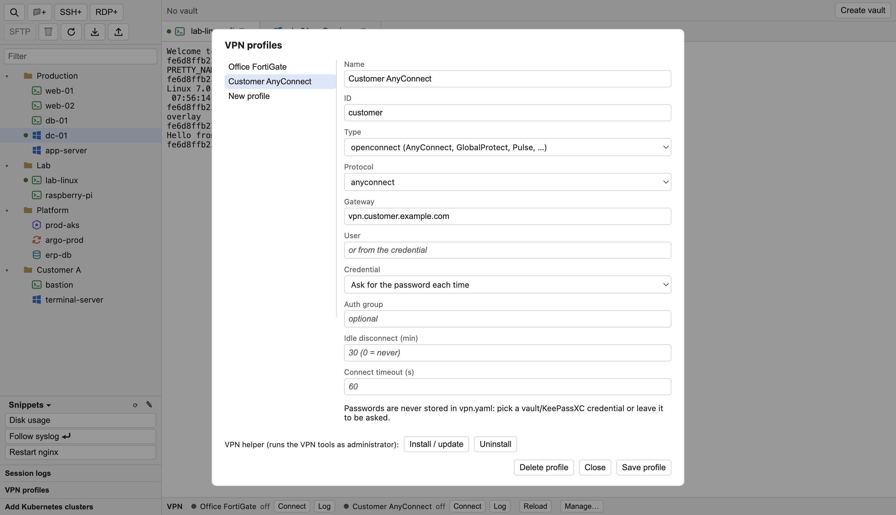
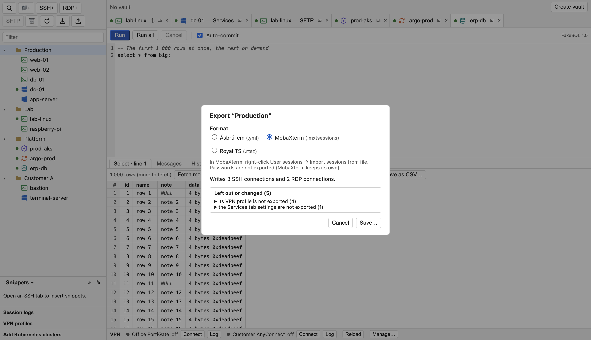
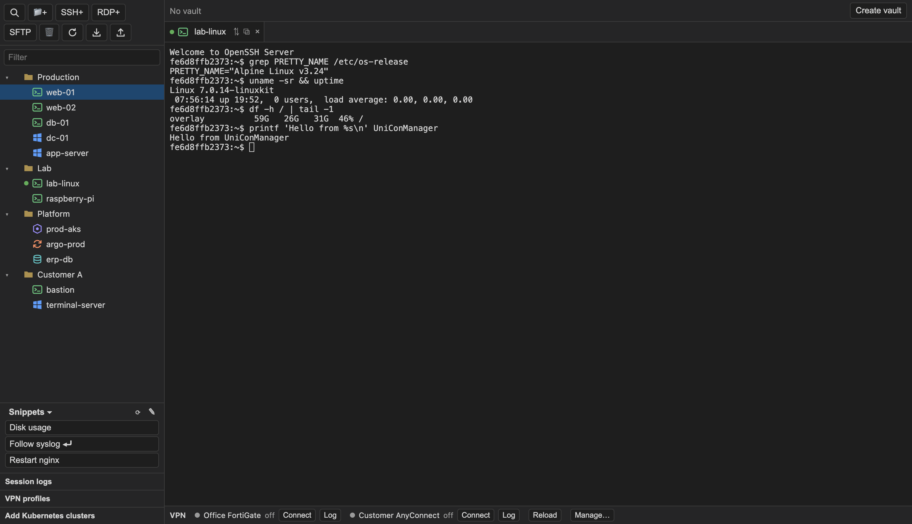

<div align="center">

# UniConManager

**All your servers, desktops, clusters and databases in one window.**

SSH · SFTP · RDP · VPN · Kubernetes · Argo CD · SQL — for macOS, Windows and Fedora

[](../../releases/latest)




</div>

---

UniConManager is a connection manager in the spirit of Royal TS and MobaXterm, built for people who look after many machines. Keep your connections in folders, let a folder give its user, jump host and VPN to everything inside it, and open what you need in tabs: a terminal, a remote desktop, a file browser, a Kubernetes cluster or a database.

## Highlights

- 🗂️ **One tree for everything.** Folders whose settings the connections inherit: user name, port, jump host, VPN, SSH options.
- 🔐 **An encrypted vault** for passwords and keys, or your **KeePassXC** database. Passwords are never written into the connection files.
- 🌐 **VPN built in.** Fortinet SSL VPN and Cisco AnyConnect / OpenConnect come up by themselves before a connection that needs them.
- 🪜 **Jump hosts.** Reach servers behind a bastion from terminals, SFTP, databases and clusters.
- 📥 **Bring your connections.** Import from Royal TS, MobaXterm and Ásbrú-cm. Export back to them as well.
- 🔄 **Updates itself.** A banner offers the new version; nothing is installed without your choice.
- 🌙 **Light and dark**, and keyboard shortcuts you can change (Ctrl+Tab, Ctrl+1…9 and more).

## A look inside

### Terminals and files
SSH terminals with session logs, snippets and quick connect (⌘K / Ctrl+Shift+K). Next to them, an SFTP browser with drag and drop, uploads and downloads.



### Remote desktops and Windows services
RDP with the clipboard, desktop size and shared folders (macOS and Fedora). For a Windows server, **Open Services** lists its services and starts, stops or restarts them over SSH.



### Kubernetes
Pods, deployments, services, nodes and custom resources, with live updates, CPU and memory, logs, a shell, files in a container, port forwards, Helm releases and **Apply YAML**. Clusters come from your kubeconfig, also through a jump host.



### Argo CD
Your applications with their sync and health state. See the diff, sync, refresh or roll back without leaving the app.



### SQL workbench
PostgreSQL, MariaDB / MySQL, Oracle (11g to 23ai) and SQL Server (2012 and newer). Run a statement or a whole script, page through large results, copy as CSV, and keep an eye on transactions. A protected connection asks for its name before anything changes data.



### Connections, VPN and moving between tools
Edit a connection and see where every inherited value comes from. Keep your VPN profiles in one list. Export a folder to Ásbrú-cm, MobaXterm or Royal TS, with a preview of what each format can take.

<p>


</p>
<p>


</p>

---

## Download

Get the newest version from **[Releases](../../releases/latest)**.

| System | File |
|---|---|
| macOS (Apple Silicon) | `UniConManager-<version>-arm64.dmg` |
| Fedora (x86_64) | `uniconmanager-<version>.x86_64.rpm` |
| Windows 10/11 (x64) | `UniConManager-Setup-<version>-x64.exe` |

The other files (`…-mac.zip`, `latest*.yml`, `.blockmap`) are used by the app's own updates; you don't need them.

## First start

**macOS.** Open the DMG and drag **UniConManager** to **Applications**. The app is not notarized by Apple, so the first start says "Apple could not verify “UniConManager” is free of malware". Click **Done**, then either:

- open **System Settings → Privacy & Security**, click **Open Anyway** next to "UniConManager was blocked" and confirm, or
- run once in Terminal: `xattr -dr com.apple.quarantine /Applications/UniConManager.app`

**Fedora.**

```bash
sudo dnf install ./uniconmanager-<version>.x86_64.rpm
```

**Windows.** Run the installer (per user, no administrator rights). It is not signed yet: on **"Windows protected your PC"** choose **More info → Run anyway** once.

## Checking a download

Each release has `SHA256SUMS.txt`:

```bash
shasum -a 256 -c SHA256SUMS.txt --ignore-missing   # macOS
sha256sum -c SHA256SUMS.txt --ignore-missing       # Fedora
```

## Updates

From version 0.4.0 on, UniConManager checks this page by itself (at start and every 6 hours; **Check for Updates…** in the app menu, or **Help** on Windows and Linux). When a new version is out, a banner offers **Update now**, **Update when closed** or **Update later**. Nothing is installed without your choice, and the app sends nothing about you: a check is a plain download of a small file from here.

- On macOS the first start after an update may ask once whether UniConManager may use its Keychain item (the remembered vault password): allow it.
- On Fedora installing an update asks for an administrator password.

<sub>The screenshots show made-up demo connections.</sub>
